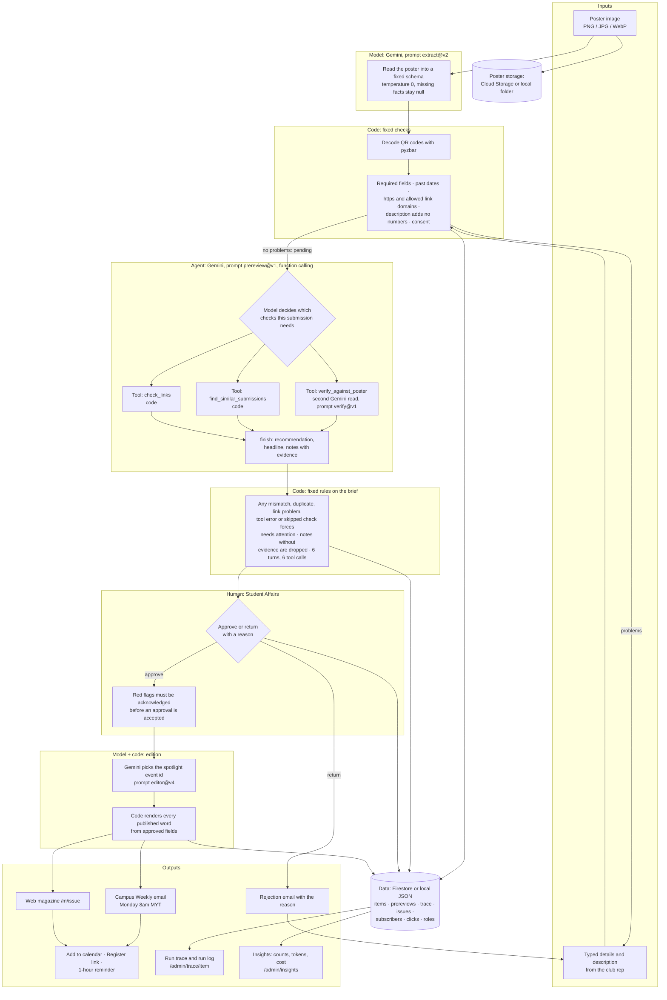

# BoardCast architecture

One poster goes in. One approved entry in Campus Weekly comes out. The model reads and advises, code enforces the rules, and a person makes every publishing decision.

## Diagram: input → model choices → tools → data → actions → output

GitHub renders this diagram. Export it as an image for the pitch deck from the GitHub page or https://mermaid.live.

## Who decides what

| Step | Decided by | What it can do | What stops it |
| --- | --- | --- | --- |
| Read the poster | Gemini (`extract@v2`) | Fill the schema from what is printed | Schema validation with one retry; "UNREADABLE" stops the read; the club confirms every field |
| QR links | Code | Decode exactly | The model is told to leave QR codes alone |
| Submission checks | Code | Send to review, or hold as a draft with reasons | Same result every time |
| Pre-review | Gemini agent (`prereview@v1`) | Choose which of three checks to call, in what order; write a brief | Cannot approve, reject or edit; each tool once; 6 turns; every turn must be a tool call |
| Second read | Gemini (`verify@v1`), called as a tool | Report match / mismatch / not on poster / unreadable per field | Only requested fields kept; date and time "mismatches" re-compared in code |
| Verdict on the brief | Code | Force "needs attention"; drop notes with no evidence | The model's wording never clears a red flag |
| Approve or return | Student Affairs | Publish or send back with a reason | Role checked on the server; stale versions refused; red flags must be acknowledged |
| Spotlight | Gemini (`editor@v4`) | Pick one event id | An id outside the approved list is replaced; no model-written prose is published |
| Delivery | Code | Send once per recipient, retry definite failures | Recipient ledger; uncertain outcomes wait for a person |

## Where control stops

- A club rep cannot approve. The server checks the role on every call, in the web UI and in the chat tools.
- The agent has no tool that writes to a submission. Its brief is saved beside the item, never inside it.
- A failed or unreachable model never blocks the workflow. Poster reading falls back to manual entry, and the brief is marked "unavailable" so a person reviews as before.
- Text supplied by a club (title, description) is passed to the model as data. An instruction inside it is reported in the brief and changes nothing.

## Run trace

Every model call, tool call, code check and human decision is one row in the `trace` collection: kind, name, actor, prompt version, model, tokens in and out, latency, and a short detail. `/admin/trace/{item_id}` shows the rows in order and exports them as Markdown. `/admin/insights` totals them.

## Deployment shape

| Local demo (verified) | Google Cloud (scripts prepared, not verified end to end) |
| --- | --- |
| FastAPI on 127.0.0.1 | Cloud Run |
| `local_data/db.json` | Firestore |
| `local_data/posters/` | Cloud Storage |
| HTML files in `local_data/outbox/` | Gmail API |
| Buttons on the review desk | Cloud Scheduler: Sunday 6pm preview, Monday 8am send, 10-minute retry, hourly reminders |
| Gemini API key | Vertex AI with a service account |
| `adk web` chat | Agent Engine + Gemini Enterprise; Teams bot |

Known cloud gap: the automatic pre-review starts in a background thread after the submit request returns. Cloud Run may pause CPU once a request ends, so in production it should be triggered by the existing `item-submitted` Pub/Sub message instead. The "Run pre-review" button runs inside a request and is unaffected.
